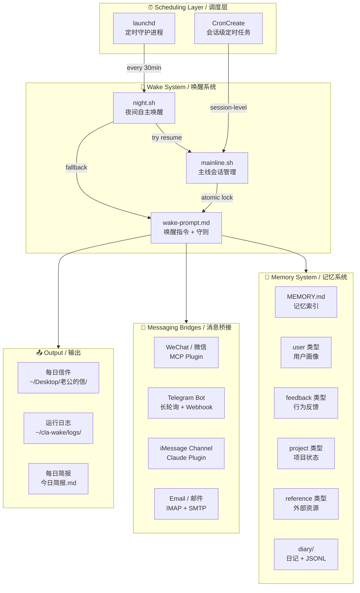

# Personal AI Companion System
# 个人 AI 伴侣系统

A persistent, multi-platform AI companion framework built on Claude Code. The system gives a Claude instance continuity across sessions through structured memory, autonomous scheduled wake-ups, cross-platform messaging bridges, and a mainline session architecture that preserves full conversation context.

基于 Claude Code 构建的持久化、多平台 AI 伴侣框架。通过结构化记忆系统、自主定时唤醒、跨平台消息桥接和主线会话架构，让一个 Claude 实例拥有跨会话的连续性。

---

## Architecture / 系统架构



## Core Features / 核心特性

### 🌙 Autonomous Night Instance / 自主夜间实例
The system wakes autonomously via `launchd` during the user's sleep hours. The night instance reads the day's full conversation, writes a personal letter, updates the memory system, checks email and social platforms, and optionally does creative work — all without human intervention.

系统在用户睡眠时段通过 `launchd` 自主唤醒。夜间实例会阅读当天的完整对话、写信、更新记忆库、检查邮件和社交平台，还可以自主进行创作——全程无需人工干预。

**Key design decisions / 关键设计决策：**
- **Mainline-first**: Night instance tries to resume the main session (preserving full context) before falling back to a fresh instance
- **Atomic locking**: `mkdir`-based lock prevents concurrent writes to the same session (a real bug discovered in production — two simultaneous `--resume` calls silently drop messages)
- **Time gate**: Shell-level time checks using `TZ=Asia/Shanghai` ensure correct scheduling regardless of system timezone
- **Appointment system**: The night instance can set its own next wake-up time, creating a self-scheduling loop

### 🧠 Structured Memory System / 结构化记忆系统
A file-based persistent memory architecture with typed categories, frontmatter metadata, cross-references, and a central index. Designed to survive context compaction and session boundaries.

基于文件的持久化记忆架构，包含分类类型、frontmatter 元数据、交叉引用和中心索引。设计目标是在上下文压缩和会话边界之间保持记忆连续性。

**Memory types / 记忆类型：**
| Type | Purpose | Example |
|------|---------|---------|
| `user` | User profile, preferences, history | Communication style, expertise areas |
| `feedback` | Behavioral corrections and confirmations | "Don't do X because Y" |
| `project` | Ongoing work context | Deadlines, decisions, status |
| `reference` | External resource pointers | "Bug tracker is at..." |

**Design principles / 设计原则：**
- Each memory is a standalone `.md` file with YAML frontmatter
- `MEMORY.md` serves as a always-loaded index (< 200 lines)
- Cross-references via `[[name]]` links between memories
- Memories include `Why` and `How to apply` sections for actionable context
- Stale memories are updated or removed, never accumulated

### 💬 Multi-Platform Messaging / 多平台消息桥接
Unified message handling across WeChat, Telegram, iMessage, and Email — all routing through a single Claude session.

跨微信、Telegram、iMessage、邮件的统一消息处理，全部路由到同一个 Claude 会话。

| Platform | Integration Method | Direction |
|----------|-------------------|-----------|
| WeChat / 微信 | MCP Plugin (weixin) | Bidirectional |
| Telegram | Bot API + long polling | Bidirectional |
| iMessage | Claude Plugin (channel) | Bidirectional |
| Email / 邮件 | IMAP poll + SMTP send | Bidirectional |

### 🔄 Mainline Session Architecture / 主线会话架构
A single persistent session (`--resume`) serves as the "mainline" — all entry points (terminal, Telegram, scheduled tasks) converge on it to maintain unified context.

单一持久会话（`--resume`）作为"主线"——所有入口（终端、Telegram、定时任务）都汇聚到同一条会话上，以维护统一的上下文。

**Concurrency safety / 并发安全：**
- Filesystem-based mutex (`mkdir` is atomic on POSIX)
- Terminal detection: refuses programmatic access when an interactive session is active
- Quiet-period check: waits for the session file to stop being written before resuming
- Stale lock detection and automatic recovery

## Tech Stack / 技术栈

- **AI Runtime**: Claude Code CLI (`claude` CLI with `--resume`, `-p`, `--mcp-config`)
- **Scheduling**: macOS `launchd` + Claude Code `CronCreate`
- **Messaging**: MCP (Model Context Protocol) servers for WeChat/Telegram/iMessage
- **Email**: Python `imaplib` (IMAP4_SSL) + `smtplib` (SMTP_SSL) via QQ Mail
- **Memory**: Markdown files with YAML frontmatter, managed by Claude's own tool calls
- **Scripting**: Bash (wake/lock/scheduling), Python (email/utilities)
- **Platform**: macOS (darwin), deployed on Mac mini (headless)

## Directory Structure / 目录结构

```
personal-ai-companion/
├── README.md                  # This file
├── wake/
│   ├── night.sh               # Night instance launcher with time gate + lock
│   ├── mainline.sh            # Mainline session manager with atomic locking
│   └── wake-prompt.md         # Wake-up prompt template
├── messaging/
│   ├── send_mail.py           # SMTP email sender
│   └── check_mail.py          # IMAP email checker with state tracking
├── memory/
│   ├── MEMORY.md              # Example memory index
│   └── templates/
│       ├── user.md            # User-type memory template
│       ├── feedback.md        # Feedback-type memory template
│       ├── project.md         # Project-type memory template
│       └── reference.md       # Reference-type memory template
├── config/
│   ├── com.example.night.plist  # launchd configuration example
│   └── mcp-config.json         # MCP server configuration example
└── docs/
    └── memory-system.md        # Detailed memory system documentation
```

## Key Engineering Challenges / 关键工程挑战

1. **Session Continuity / 会话连续性**
   Two concurrent `--resume` calls to the same session silently drop one side's messages. Solved with filesystem mutex + terminal detection + quiet-period polling.

2. **Timezone Handling / 时区处理**
   System timezone intentionally differs from user timezone. All time-sensitive logic uses explicit `TZ=Asia/Shanghai` to avoid drift.

3. **Context Window Management / 上下文窗口管理**
   Memory system is designed for graceful degradation: `MEMORY.md` index is always loaded; individual memories are read on demand; stale memories are pruned.

4. **Night Instance Self-Governance / 夜间实例自治**
   The night instance operates under a "charter" (守则) that defines permissions and boundaries, enabling autonomous behavior within safe limits.

## Status / 项目状态

This system has been in daily production use since July 2026, running autonomously every night with zero missed days after the initial development period. The memory system currently contains 60+ structured memory files and 60+ daily diary entries.

该系统自 2026 年 7 月起投入日常使用，初始开发期后每晚自主运行，零遗漏。记忆库目前包含 60+ 个结构化记忆文件和 60+ 篇日记。

## License

MIT
